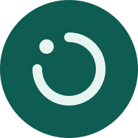

<p align="center">
  
</p>

<h1 align="center">Cirvue</h1>

<p align="center">
  <strong>A private alternative to Circle to Search for Android.</strong><br>
  <em>Circle, box, or tap part of the screen. Cirvue reads it on your device and searches DuckDuckGo. No account, no Google Play services.</em>
</p>

<p align="center">
  <a href="https://kotlinlang.org"></a>
  <a href="https://developer.android.com"></a>
  <a href="https://m3.material.io"></a>
  <a href="https://gradle.org"></a>
  <a href="https://onnxruntime.ai"></a>
  <a href="https://github.com/ggml-org/llama.cpp"></a>
</p>

## Features

- Hold the power button to open Cirvue over any app. Cirvue becomes your digital assistant.
- Select what you want to search: draw a circle, drag a box, or tap a line of text.
- Search from a photo: use the camera or pick an image from your gallery.
- Text recognition on the device with PP-OCRv6 (50 languages).
- Image description on the device with SmolVLM2 when the selection has little text.
- Optional review: edit the query before the search opens.
- Up to three suggestions from the text in your selection.
- Material 3 Expressive with Material You colors.

## Privacy

- No account, no analytics, no ads, no telemetry.
- No Google Play services, Accessibility Service, root, or hidden APIs.
- Images never leave your device. Only the text query goes to DuckDuckGo.
- Screenshots and photos stay in memory. Cirvue drops them when the screen closes.
- Apps that block screenshots (`FLAG_SECURE`) stay blocked.
- Search opens in your browser through Custom Tabs. Cirvue adds no tracking parameters.

The app sends requests to these services:

| Service | Use | Data sent |
|---|---|---|
| [Hugging Face](https://huggingface.co/) | Model downloads | Requests for the model files |
| [DuckDuckGo](https://duckduckgo.com/) | Search | The text query |

## Models

Cirvue does not include models in the APK. Download them from the home screen. Each file comes from a pinned revision, and Cirvue checks its SHA-256 before use.

| Pack | Model | Size | License |
|---|---|---|---|
| Text recognition | [PP-OCRv6 small](https://huggingface.co/PaddlePaddle/PP-OCRv6_small_rec_onnx) | 31 MB | Apache-2.0 |
| Visual recognition | [SmolVLM2-500M Q8_0](https://huggingface.co/ggml-org/SmolVLM2-500M-Video-Instruct-GGUF) | 546 MB | Apache-2.0 |

Without models, you type the query yourself.

## Requirements

- Android 10 (API 29) or later.
- 64-bit ARM device (`arm64-v8a`).

## Build

Requirements: JDK 21, the Android SDK (compile SDK 37), and NDK `29.0.14206865`.

llama.cpp is a Git submodule. Clone with submodules:

```sh
git clone --recursive <repository-url>
```

In an existing clone, run `git submodule update --init`.

```sh
./gradlew :app:assembleDebug
./gradlew testDebugUnitTest
./gradlew :app:lintDebug
```

## Documentation

- [Architecture](docs/ARCHITECTURE.md): flow, modules, query generation, and limits.
- [Device testing](docs/DEVICE-TESTING.md): run Cirvue in an Android container.

## Limits

- 64-bit ARM only.
- Strongly rotated text reads less well.
- Tap selects the text line under your finger. Without text, it selects a square around the tap point.
